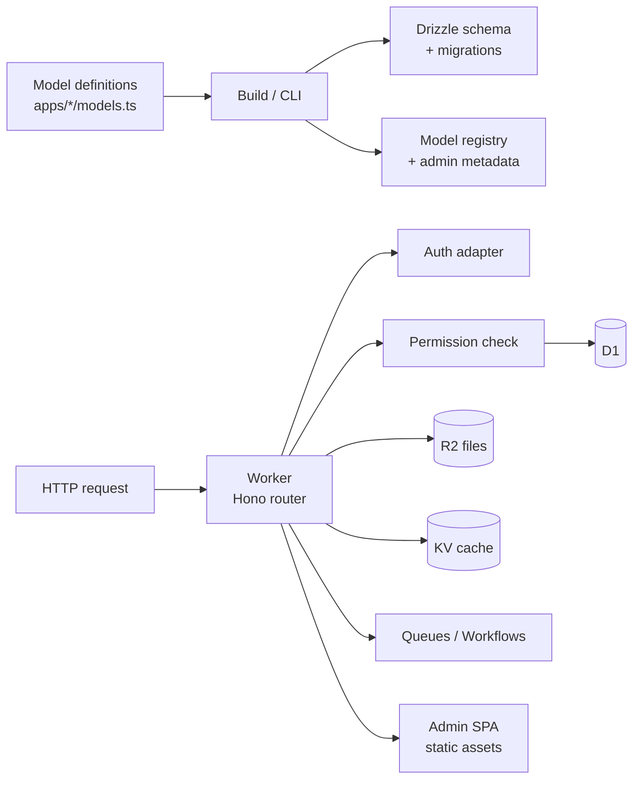

# Clango — Django-style Framework on Cloudflare — Build Spec v2

2026-09-22 · annotated v2

> **How to read v2.** This is the authoritative spec; v1 lives only as history. Changes made after
> a docs review on 2026-09-22 are marked `> **v2:**`. A summary of every change is in
> [Change log](#change-log-v1--v2) at the end. Platform facts verified against the Cloudflare docs
> are listed in [Verified platform facts](#verified-platform-facts) — re-verify these per milestone
> and log deviations in `docs/DECISIONS.md`.

## Overview and goals

We are building a TypeScript framework for Cloudflare Workers that works like Django: developers
define models inside apps, and the framework generates the database schema, migrations, a REST API
and a full admin panel automatically. Working name: **Clango**.

The framework uses Cloudflare services for everything except identity: D1, R2, KV, Queues,
Workflows, Durable Objects, Cron Triggers and Browser Rendering. Authentication comes from an
external library behind an adapter.

**Goals**

- One model definition is the single source of truth for schema, validation, API and admin.
- A working admin appears the moment a model is registered, with zero UI code.
- Django-familiar concepts: apps, models, `ModelAdmin`, migrations, permissions, background tasks,
  management commands.
- Runs entirely on Workers with no long-running servers.
- Scales by composing many small D1 databases rather than one large one.

**Non-goals for v1**

- Building our own authentication (identity is delegated).
- Server-rendered templates for public sites (the framework is API + admin first).
- Supporting runtimes other than Cloudflare Workers.
- Loading plugins at runtime (apps are composed at build time).

## Instructions for Claude Code

Work milestone by milestone (see [Milestones](#milestones)) and do not start the next one until the
current one's acceptance criteria pass.

1. Before writing code, read this whole spec, then check the current Cloudflare docs for any service
   you touch. Limits and APIs change; if the docs disagree with this spec, follow the docs and note
   the difference in `docs/DECISIONS.md`.
2. Create a `CLAUDE.md` at the repo root summarising the conventions below so future sessions pick
   them up.
3. Keep a running `docs/DECISIONS.md` (short ADR-style entries) for every non-obvious design choice.
4. Verify every milestone with tests and a running example app, not just type-checking.

**Conventions**

- TypeScript strict mode everywhere; no `any` in public APIs.
- pnpm workspaces monorepo; Vitest with `@cloudflare/vitest-plugin` for tests that run inside the
  Workers runtime (see D-019 — this supersedes v1/v2's `@cloudflare/vitest-pool-workers`).
- Wrangler for local dev and deploys; all bindings declared in `wrangler.jsonc`.
- No Node-only APIs in runtime packages (CLI package may use Node).
- Public APIs get TSDoc comments and at least one test.
- Prefer small, composable packages over one large one.

**Definition of done for any feature**

- [ ] Unit tests pass under the Workers test pool.
- [ ] The `examples/blog` app exercises the feature.
- [ ] `wrangler dev` runs the example with no errors.
- [ ] Docs page or README section updated.

## Tech stack and Cloudflare service mapping

The runtime is Cloudflare Workers with Hono for routing, Drizzle ORM over D1, Zod for validation,
and a React + Vite SPA for the admin served from Workers static assets.

| Django concept               | Clango equivalent                          | Notes                                                               |
| ---------------------------- | ------------------------------------------ | ------------------------------------------------------------------- |
| Models / ORM                 | `defineModel` → Drizzle schema on D1       | SQLite dialect; one D1 binding per database group                   |
| `makemigrations` / `migrate` | `clango makemigrations` / `clango migrate` | Generates SQL files applied with `wrangler d1 migrations apply`     |
| `FileField` / `ImageField`   | `fields.file()` → R2                       | Presigned upload URLs; DB stores the object key                     |
| Cache framework              | KV + Cache API                             | Eventually consistent; never for auth or permission state           |
| Celery tasks, signals        | Queues                                     | `defineTask()` producer/consumer with retries and dead-letter queue |
| Multi-step jobs              | Workflows                                  | Imports, exports, long-running admin actions                        |
| Celery beat                  | Cron Triggers                              | `defineSchedule()` registered in config                             |
| Locks, counters, realtime    | Durable Objects                            | Row locks for admin editing, rate limits, live updates              |
| PDF / screenshot export      | Browser Rendering                          | Admin "Export as PDF" action                                        |
| Search                       | SQLite FTS5 in D1                          | Optional Vectorize adapter later                                    |
| `INSTALLED_APPS`             | `clango.config.ts` `apps: []`              | Composed at build time                                              |
| Auth                         | External library via `AuthAdapter`         | Better Auth as the reference adapter                                |
| Permissions, groups          | Built into Clango, stored in D1            | Authorization is ours, identity is theirs                           |

## Architecture and repo layout

A single Worker serves the API, the admin SPA and queue consumers; model definitions feed a build
step that emits schema, migrations and admin metadata.



Requests pass through the auth adapter, then the permission layer, before any data access. Heavy
work leaves the request path through Queues or Workflows.

```
clango/
  packages/
    core/        # defineModel, fields, registry, app config
    orm/         # Drizzle generation, query helpers, DB routing
    migrate/     # schema diffing, SQLite table-rebuild migrations
    api/         # auto-generated REST routes (Hono)
    admin-api/   # admin metadata endpoint, admin actions
    admin-ui/    # React + Vite SPA, generic list/detail/form views
    auth/        # AuthAdapter interface, permissions, groups
    auth-better-auth/  # reference adapter
    files/       # R2 file fields, presigned uploads
    tasks/       # Queues tasks, Workflows, cron schedules
    cache/       # KV + Cache API helpers
    cli/         # clango init / startapp / makemigrations / migrate / createsuperuser
  examples/
    blog/        # reference app used by every milestone
  docs/
    SPEC.md
    DECISIONS.md
```

## Core API design

The model definition API is the most important design decision: everything else is generated from
it, so it must be typed end to end and readable at runtime. These sketches are the target shape;
refine names but keep the structure.

**Model definition** (`apps/blog/models.ts`)

```ts
import { defineModel, fields } from "@clango/core";

export const Author = defineModel("blog.Author", {
  fields: {
    name: fields.string({ max: 120 }),
    email: fields.email({ unique: true }),
    avatar: fields.image({ optional: true }),
  },
  display: (a) => a.name,
});

export const Post = defineModel("blog.Post", {
  fields: {
    title: fields.string({ max: 200 }),
    slug: fields.slug({ from: "title", unique: true }),
    body: fields.text({ searchable: true }),
    status: fields.choice(["draft", "published"], { default: "draft" }),
    author: fields.foreignKey(() => Author, { onDelete: "cascade" }),
    publishedAt: fields.datetime({ optional: true, index: true }),
  },
  meta: { ordering: ["-publishedAt"] },
});
```

Every model gets `id` (ULID string), `createdAt` and `updatedAt` automatically. Types for rows,
inserts and updates are inferred from the definition.

> **v2 — typing strategy.** `defineModel` inference is the top delivery risk. Commit to a two-pass
> design: fields are captured `as const`, then row/insert/update types are produced with mapped
> types; `foreignKey`/`manyToMany` take a lazy `() => Model` reference returning `ModelRef<T>` that
> carries a phantom type only (never a value), so the runtime graph stays acyclic while the type
> graph resolves. Benchmark `tsc --extendedDiagnostics` on `examples/blog` in M1 and treat editor
> responsiveness as an acceptance criterion, not an afterthought.

**Field types for v1**

| Field                            | SQLite type             | Admin widget        | Notes                                     |
| -------------------------------- | ----------------------- | ------------------- | ----------------------------------------- |
| `string`, `email`, `slug`, `url` | TEXT                    | Text input          |                                           |
| `text`                           | TEXT                    | Textarea            | 2 MB row/string cap — validate            |
| `integer`                        | INTEGER                 | Number input        |                                           |
| `decimal`                        | INTEGER (minor units)   | Number input        | **v2:** never store money as TEXT/NUMERIC |
| `boolean`                        | INTEGER (0/1)           | Checkbox            |                                           |
| `datetime`                       | INTEGER (epoch ms, UTC) | Date picker         | Always store UTC                          |
| `date`                           | TEXT (`YYYY-MM-DD`)     | Date picker         |                                           |
| `choice`                         | TEXT + CHECK            | Select              |                                           |
| `json`                           | TEXT                    | JSON editor         | 2 MB cap — validate                       |
| `foreignKey`                     | TEXT + FK               | Searchable select   |                                           |
| `manyToMany`                     | join table              | Multi-select        |                                           |
| `file`, `image`                  | TEXT (R2 key)           | Upload with preview |                                           |

> **v2 — decimal.** v1 mapped `decimal` to `INTEGER / TEXT`. SQLite gives TEXT columns no numeric
> ordering, so storing decimals as TEXT breaks range filters and sorts. `fields.decimal()` stores
> integer minor units with a declared `scale` (e.g. `{ scale: 2 }` → cents), and the ORM converts on
> read/write. Money never touches REAL.

**Admin registration** (`apps/blog/admin.ts`)

```ts
import { registerAdmin, action } from "@clango/admin-api";
import { Post } from "./models";

registerAdmin(Post, {
  listDisplay: ["title", "author", "status", "publishedAt"],
  listFilter: ["status", "author"],
  searchFields: ["title", "body"],
  readonlyFields: ["slug"],
  fieldsets: [
    { title: "Content", fields: ["title", "slug", "body"] },
    { title: "Publishing", fields: ["status", "author", "publishedAt"] },
  ],
  actions: [
    action("publish", "Publish selected", async (ids, ctx) => {
      await ctx.enqueue("blog.publishPosts", { ids }); // runs in Queues
    }),
  ],
});
```

**App and project config**

```ts
// apps/blog/index.ts
export default defineApp({ name: "blog", models: [Author, Post], database: "DB_MAIN" });

// clango.config.ts
export default defineConfig({
  apps: [blog, accounts],
  auth: betterAuthAdapter({/* ... */}),
  databases: { DB_MAIN: { binding: "DB_MAIN" } },
  files: { binding: "FILES" },
  cache: { binding: "CACHE" },
});
```

## Subsystems

### ORM and migrations

Generate a Drizzle SQLite schema from the registry and wrap it in a thin query API
(`Post.objects.filter(...)`-style helpers are optional; plain Drizzle access must always work).

> **v3 — the Drizzle schema is built at runtime, not generated.** `@clango/orm`'s `buildTable(model)`
> constructs `sqliteTable(...)` from the field definitions when the module loads, so there is no
> generated schema file to drift out of sync (D-025). Foreign keys are deliberately absent from the
> Drizzle schema — SQLite enforces them through the emitted DDL, and Drizzle does not need them to
> build queries; relation metadata arrives with the query API in M2.

- `makemigrations` diffs the current registry against a stored snapshot
  (`migrations/<database>/_snapshot.json`) and writes numbered `.sql` files.
- SQLite cannot drop or alter most columns in place. For those changes, emit the table-rebuild
  pattern: create new table, copy rows, drop old, rename, recreate indexes, inside a transaction
  with foreign-key enforcement deferred.
- Destructive changes (drop column, drop table) require an explicit `--allow-destructive` flag.
- Auto-create indexes for foreign keys and for fields used in `listFilter`, `ordering` and
  `index: true`.
- `searchable: true` text fields get an FTS5 virtual table kept in sync with triggers.

> **v2/v3 — table rebuilds use `defer_foreign_keys`, and `DROP TABLE` cascades.** Verified in M1
> against the Workers runtime and `wrangler d1 migrations apply`:
>
> 1. **Never emit `BEGIN`/`COMMIT`.** D1 already executes a migration inside one transaction;
>    explicit transaction control fails with "cannot start a transaction within a transaction".
>    `applyD1Migrations` runs each file through `db.batch()`, and wrangler applies the file
>    atomically, so both paths are transactional on their own.
> 2. Emit `PRAGMA defer_foreign_keys = on` once at the top of any migration containing a rebuild or
>    a table drop. `PRAGMA` scope is the current transaction, which is exactly the migration.
> 3. **`DROP TABLE` performs an implicit `DELETE` while foreign keys are enabled.** This fires
>    `ON DELETE CASCADE` and `ON DELETE SET NULL` on every child table, so the naive
>    create/copy/drop/rename rebuild silently destroys child rows. The planner must back up and
>    restore the transitive closure of affected child tables around the rebuild (see D-023).
> 4. `PRAGMA legacy_alter_table = on` does **not** prevent `ALTER TABLE ... RENAME` from rewriting
>    child `REFERENCES` clauses in D1, so it cannot be used to sidestep point 3 (see D-024).
> 5. `ON DELETE RESTRICT` cannot be deferred by SQLite and blocks a rebuild outright; the planner
>    rejects it with an explanatory error.
>
> Tests assert that child rows survive a parent rebuild, that `PRAGMA foreign_key_check` is clean
> afterwards, and that cascades still fire.

> **v2/v3 — migration file layout.** The CLI writes one directory per database —
> `migrations/<database>/` — containing numbered `NNNN_name.sql` files plus a committed
> `_snapshot.json`. Set the D1 binding's `migrations_dir` to the same path; `wrangler d1 migrations
apply` reads the directory from `wrangler.jsonc` (it has no `--migrations-dir` flag).

> **v2 — triggers in migrations.** Verified in M1: `CREATE TRIGGER ... BEGIN ... END` is split
> correctly by wrangler's `unstable_splitSqlQuery` (the same splitter the test pool uses) and
> applies cleanly through `wrangler d1 migrations apply`. No workaround is needed.

### Generated REST API

Each model gets `GET /api/<app>/<model>` (list, cursor pagination, filters, search), `GET /:id`,
`POST`, `PATCH /:id`, `DELETE /:id`. Input is validated with the generated Zod schema. Exposure is
opt-in per model (`api: { enabled: true, ops: ["list", "retrieve"] }`) so nothing is public by
accident.

> **v4 — implemented in M2.** `@clango/api` mounts the routes onto the application's Hono app with
> `mountApi(app, config)`; a disabled operation is not mounted at all, so it returns `404` rather
> than `403` (D-029). The concrete surface:
>
> - Paths use the snake_case model name: `/api/blog/post`, `/api/blog/post/:id`.
> - List query parameters: `cursor`, `limit` (default 25, max 100), `order` (`-field` for
>   descending, at most three keys), `search`, and one parameter per filterable field. Filters take
>   an optional operator suffix — `?status=draft`, `?rating.gte=4`, `?status.in=draft,published`.
>   Filtering and ordering are restricted to scalar columns; `text`, `json`, `file` and `image` are
>   excluded, and range operators are only accepted for ordered types.
> - Ordering defaults to `meta.ordering` with `id` appended as a tie breaker. Cursors embed the
>   ordering signature and reject a mismatched `order` with `400` (D-030).
> - The list response is `{ data, page: { count, countCapped, limit, hasMore, nextCursor } }`, with
>   `count` clamped to 10,000 and `countCapped` signalling a lower bound (D-031).
> - `search` runs through the model's FTS5 index with every token quoted and prefix-matched; raw
>   `MATCH` syntax is never reachable from input (D-032).
> - Errors are always JSON: `{ error: { code, message, details? } }`, with `validation_error` (400),
>   `not_found` (404), `conflict` (409) and `invalid_reference` (400) mapped from D1 constraint
>   failures. `mountApi` installs those handlers on the host app because Hono does not carry a
>   sub-app's `notFound` across `route()` (D-033).

### Admin backend and UI

- `GET /admin/api/meta` returns every registered model the current user can view: fields, types,
  widgets, list config, actions and permissions.
- The SPA is fully generic. It renders the sidebar, list view (sortable columns, filters, search,
  bulk actions), detail/edit form (fieldsets, inline validation errors, FK search), and delete
  confirmation with a cascade preview.
- Lists use cursor pagination. Never run unbounded `COUNT(*)`; show exact counts up to 10,000 and
  "10,000+" beyond.
- Custom admin pages and field widgets can be registered as React components later; v1 only needs
  the generic views.
- Every admin write is recorded in a `clango_admin_log` table (who, what, when, diff), like
  Django's `LogEntry`.

> **v5 — implemented in M3.** `@clango/admin-api` serves `/admin/api/*` and `@clango/admin-ui` is the
> SPA. The concrete surface:
>
> - **Opt-in.** `defineConfig({ admin: { enabled: true } })` is required; it also registers
>   `clango.AdminLog` so `makemigrations` creates the audit table (D-035). The admin stays
>   unauthenticated until M4, which is why it is not on by default.
> - **Meta.** `GET /admin/api/meta` returns every registered model with field widgets, requiredness,
>   read-only flags, list configuration, fieldsets, actions, and the related model plus
>   `labelField` for each relation. `user` is `null` until M4.
> - **CRUD.** `GET|POST /admin/api/<app>/<model>` and `GET|PATCH|DELETE /admin/api/<app>/<model>/:id`
>   reuse the REST layer's validation, keyset pagination, filters, search and bounded counts — and
>   are independent of `api.enabled`, so a model can be managed in the admin without being public.
> - **Audit.** Every write is batched with its `clango_admin_log` insert, so a failed mutation logs
>   nothing and a successful one cannot go unlogged (D-015). Updates record a per-field
>   `{ from, to }` diff and skip the entry entirely when nothing actually changed.
> - **Relations.** `GET …/options` backs both list labels and searchable selects, using FTS5 when
>   the target has searchable fields and a bounded prefix `LIKE` otherwise (D-037).
> - **Cascade preview.** `GET …/:id/cascade` walks `ON DELETE CASCADE` and `SET NULL` edges
>   transitively within a row budget, and reports `capped` when it stops early (D-036).
> - **Actions.** `POST …/actions/<name>` runs a registered action over the selected ids inline;
>   M5 moves long-running actions behind Queues.
> - **SPA.** HeroUI v3 + Tailwind v4, following the house frontend layout: sidebar grouped by app,
>   list view with sortable columns, filters, search, bounded counts and bulk actions, an edit form
>   driven by fieldsets with inline validation errors and relation search, and a delete screen
>   showing the cascade preview (D-038).
>
> Static assets are served alongside the Worker. `run_worker_first` must list every Worker-owned
> route positively — see D-040 for why a catch-all with negative exclusions is wrong.

> **v2 — bounded counts.** "Exact count up to 10,000" still needs a bound or it scans the whole
> table (and D1 bills rows read). Implement it as
> `SELECT COUNT(*) FROM (SELECT 1 FROM t WHERE … LIMIT 10001)` or by fetching `limit + 1` rows, then
> render "10,000+" when the sentinel is hit. Never issue a bare `COUNT(*)`.

> **v2 — `LIKE` is capped at 50 bytes in D1.** Any admin search or free-text filter implemented
> with `LIKE '%term%'` breaks once a user types ~50 characters. Route all user-supplied search
> through FTS5 `MATCH`; reserve `LIKE` for short, server-controlled values (slugs, prefixes).

> **v2 — admin log cost.** One log row per admin write doubles write volume on a single-threaded
> database. Keep the log, but write it in the same `db.batch()` as the mutation, keep the diff
> small, and make retention configurable.

### Auth adapter and permissions

```ts
interface AuthAdapter {
  getUser(req: Request, env: Env): Promise<ClangoUser | null>;
  handler?: (req: Request, env: Env) => Promise<Response>; // mounts the library's routes
}
interface ClangoUser {
  id: string;
  email: string;
  isStaff: boolean;
  isSuperuser: boolean;
}
```

The auth library answers "who is this?"; Clango owns "what may they do?". Every model gets `view`,
`add`, `change` and `delete` permissions automatically. Users get permissions directly or through
groups, stored in D1 (`clango_group`, `clango_permission` and join tables). Only `isStaff` users
reach `/admin`. Permission lookups are cached per request, never in KV.

> **v6 — implemented in M4.** `@clango/auth` owns authorization, `@clango/auth-better-auth` is the
> reference identity adapter. The concrete surface:
>
> - **Adapter.** `AuthAdapter.getUser(request, env)` returns `AuthIdentity { id, email }` — identity
>   only. A provider cannot claim authority, because staff flags, groups and grants are read from
>   Clango's tables (D-041).
> - **Tables.** `clango_user` (email, optional `authId`, `isStaff`, `isSuperuser`), `clango_group`,
>   `clango_user_group`, `clango_group_permission`, `clango_user_permission`. They are framework
>   models registered when `auth.enabled` is set, so migrations create them (D-035's mechanism).
>   A user row is provisioned on first authenticated request and linked to the provider's id by
>   email (D-043).
> - **Catalogue.** Derived from the registry: every model contributes
>   `<app>.view|add|change|delete_<model>`, including the framework tables, so groups can be managed
>   in the admin. Grants store the codename (D-042).
> - **Enforcement.** `/admin` and `/admin/api/*` require a staff account. Each operation then checks
>   its permission: list/retrieve need `view`, create `add`, update `change`, delete `delete`,
>   relation options `view` on the target, and cascade previews and actions `delete`/`change`. The
>   meta endpoint returns only models the caller can read, with per-model `permissions` so the SPA
>   hides what it cannot do. Middleware is registered before the routes it guards (D-044).
> - **`clango createsuperuser --email <address> [--local|--remote]`** appoints a superuser before
>   they can sign in (D-043).
> - **Better Auth.** `createBetterAuthAdapter` builds the instance lazily per environment from a
>   binding name, so `clango.config.ts` never needs an environment (D-046). Its own tables are
>   generated with its CLI and committed as a migration.
> - **Scope.** Permissions gate the admin. The REST API keeps opt-in exposure as its control, and
>   projects needing authenticated API access can compose `clangoAuth`/`requirePermission` (D-047).
>
> Still to come: a sign-in UI (the SPA explains a 401 rather than rendering a form) and
> multi-tenant permission scoping.

> **v2 — auth integration details.** Better Auth runs inside the same Worker, so "external" means
> library-owned, not out-of-process. Three decisions to make explicit:
>
> 1. **Session lookup cost.** `getUser()` per request is a DB round trip — enable Better Auth's
>    cookie cache and treat the session lookup as a hot path.
> 2. **Table ownership.** Decide whether auth tables live in the app D1 or a dedicated auth D1
>    (a separate DB keeps auth writes off the app's single-threaded database). Default: dedicated
>    auth database when more than one app database exists.
> 3. **Authorization stays ours.** `isStaff`/`isSuperuser` and all permissions are read from
>    Clango tables, never from the auth library's user record, so the identity provider can be
>    swapped without touching authorization.

### Files (R2)

Uploads use a two-step flow: the admin asks for a presigned URL, uploads directly to R2, then saves
the returned key on the record. Keys are namespaced `<app>/<model>/<id>/<uuid>-<filename>`.
Downloads of private files go through a Worker route that checks permissions. Deleting a record
enqueues cleanup of its files.

> **v2 — presigning requirements.** The R2 _binding_ cannot sign URLs. Presigned URLs require an
> **R2 S3 API token** (access key ID + secret) plus the account ID, signed with `aws4fetch`
> (Workers-compatible; the AWS SDK also works). Constraints to design around:
>
> - Supported methods: `GET`, `HEAD`, `PUT`, `DELETE`. **POST multipart form uploads are not
>   supported** — the SPA must use `PUT`.
> - Expiry range: 1 second to 7 days. Default to short (≤15 min) for uploads.
> - **Presigned URLs cannot be revoked** before expiry. Keep TTLs short and treat the key as
>   untrusted until the record is saved.
> - The bucket needs a CORS policy allowing `PUT` from the admin origin.
> - Store the S3 credentials as Worker secrets, never in `clango.config.ts`.
>
> Orphaned uploads (URL issued, record never saved) need a cleanup pass — extend the delete-cleanup
> task to sweep unreferenced keys older than 24h.

### Tasks, workflows and schedules

- `defineTask("blog.publishPosts", schema, handler)` registers a Queues consumer;
  `ctx.enqueue(name, payload)` sends a validated message. Configure retries and a dead-letter queue
  by default.
- Long multi-step jobs (CSV import, full export) use Workflows so they survive restarts and report
  progress to the admin.
- `defineSchedule("0 3 * * *", handler)` maps to Cron Triggers.
- Model lifecycle hooks (`beforeSave`, `afterSave`, `afterDelete`) run in-request; anything slow
  must enqueue a task instead.

> **v7 — implemented in M5.** `@clango/files`, `@clango/tasks` and `@clango/cache`, with the blog
> wiring all three.
>
> - **Tasks.** `defineTask(name, zodSchema, handler)` registers a handler and the Worker's `queue`
>   export runs `handleQueueBatch`. The consumer wraps every message in its own try/catch and uses
>   explicit `ack()`/`retry()`, because an uncaught error retries the _entire_ batch. Invalid
>   payloads and unknown task names are acknowledged rather than retried, since retrying them can
>   never succeed. `createEnqueuer(queue)` validates a payload before it is sent, so a bad payload
>   fails where the request context still exists.
> - **Actions.** `AdminActionContext.enqueue` is present when `tasks.binding` is configured. The
>   blog's publish action enqueues a task instead of writing in the request, which is the pattern for
>   anything that may exceed the Worker CPU budget.
> - **Files.** `POST /admin/api/<app>/<model>/uploads` issues a presigned PUT for a namespaced key
>   (`<app>/<model>/<record id>/<uuid>-<filename>`); the client uploads straight to R2 and stores the
>   key. `GET /files/<key>` streams private objects after checking the caller's `view` permission on
>   the owning model. Deleting or re-pointing a file field enqueues `clango.cleanup_files`, and
>   `sweepOrphans` collects uploads no record ever claimed (D-049…D-051).
> - **Schedules.** `defineSchedule(name, "0 3 * * *", handler)` registers a cron handler and the
>   Worker's `scheduled` export routes the wake-up to the schedules that match. The expression must
>   also be listed under `triggers.crons` in `wrangler.jsonc` (D-052).
> - **CSV.** `exportCsv` and `importCsv` page a table one chunk at a time and never hold it in
>   memory, so a Workflow can drive them across steps (D-053).
> - **Cache.** `createCache(env.CACHE, { prefix })` wraps KV with `get`/`set`/`wrap`/`invalidate` and
>   rejects TTLs shorter than KV's 60-second minimum (D-048). The blog's `/stats` route demonstrates
>   a read-heavy, staleness-tolerant endpoint.
>
> Still to come: a Workflow-backed CSV job in the example (the helpers are tested; the Workflow
> runtime is not exercised in the test pool), and generating `run_worker_first` from the routes.

> **v2 — queue payload discipline.** Queues cap messages at 128 KB and an uncaught error retries the
> **entire batch**, so the task runtime must wrap every message in its own `try/catch` with explicit
> `ack()`/`retry()`. For bulk actions, never enqueue a raw id list: enqueue a _query descriptor_
> (model, filters, cursor) and let the consumer page through it. A "publish everything matching
> this filter" action over 100k rows would otherwise exceed the message limit.

### Cache

KV-backed helpers for read-heavy, staleness-tolerant data (`cache.get`, `cache.set` with TTL,
`cache.wrap`). Document clearly that KV can take up to about 60 seconds to propagate, so sessions,
permissions and counters never live there.

## Scalability design and constraints

Workers compute scales on its own; D1 is the constraint, so the framework must make "many small
databases" the default path. Each D1 database is a single SQLite instance with serialized writes
and a per-database size cap that **cannot be increased** (see
[Verified platform facts](#verified-platform-facts)).

**Database routing.** Every app declares which D1 binding it lives in. Models in the same database
may use foreign keys and joins; cross-database relations are rejected at definition time with a
clear error. The ORM resolves the right binding per query through a `DatabaseRouter`.

**Multi-tenancy (milestone 6).** Support a database-per-tenant mode: a tenant resolver maps the
request (subdomain, header or path) to a D1 database ID, and `clango migrate --all-tenants` applies
migrations to every tenant database through the Cloudflare API with progress tracking in a
Workflow.

> **v2 — tenant resolution cannot be a binding lookup.** Workers bindings are static, and a single
> Worker script can bind roughly 5,000 D1 databases (account cap is 50,000). The v1 sketch of
> "resolver returns a database ID and the ORM uses it" has no runtime mechanism behind it. M6 must
> open with a spike comparing:
>
> 1. **D1 HTTP API** — call `/accounts/{id}/d1/database/{db_id}/query` from the Worker with an API
>    token. Simple, but adds a network hop and bypasses bindings/read replication.
> 2. **Workers for Platforms / dispatch namespaces** — one tenant Worker per shard, each with a
>    bounded set of bindings. More operationally complex, closest to Cloudflare's intended model.
> 3. **Bounded binding pool** — pre-bind N tenant databases and shard tenants across them, moving
>    to option 1 or 2 past N.
>
> Record the choice in `DECISIONS.md` before writing migration tooling. `migrate --all-tenants`
> also needs its own rate-limit/backoff strategy against the Cloudflare API.

**Read replicas.** Use D1's Sessions API for read replication so admin list views read from nearby
replicas while writes stay consistent. Keep a `session` per request so users read their own writes.

> **v2 — sessions are safe to adopt now.** `withSession()` works even on databases without read
> replication enabled, so the code path can ship before the feature is switched on per database.
> Always `session.close()` in a `finally`. Sessions support long timeouts (up to 15 minutes) for
> migrations/backfills — use that instead of unbounded single statements.

**Query rules the framework enforces**

- Cursor pagination everywhere; no large `OFFSET`.
- Capped counts in the admin (see [Admin backend](#admin-backend-and-ui)).
- Indexes generated for every filter, ordering and FK field.
- Bulk admin actions over more than 100 rows run in Queues, not in the request.
- Batch writes with `db.batch()` to minimise round trips.

> **v2 — additional hard limits the query layer must respect.** A maximum of **100 bound parameters
> per query** (chunk every `IN (…)`, bulk insert and bulk update), 100 KB per SQL statement, 2 MB
> per row/string/BLOB, 100 columns per table, and a 30-second query ceiling. Put these in shared
> constants and assert on them in the query builders; don't let them surface as runtime errors in
> user code.

**CPU and request limits.** Anything that may exceed the Worker CPU budget (imports, exports, image
processing, PDF generation) must go through Queues or Workflows. Add a lint or runtime warning when
an admin action runs long in-request.

**Escape hatch.** Keep the ORM layer behind a driver interface so a project can later point some
apps at Postgres through Hyperdrive without changing model definitions. Only the D1 driver ships in
v1, but the interface must exist from day one.

> **v8 — implemented in M6.** `@clango/orm` gained the driver seam, tenancy and sessions; the CLI
> gained `--all-tenants`.
>
> - **Cross-database relations are rejected at definition time.** `collectRegistry` walks every
>   `foreignKey` and `manyToMany` and refuses a target in another database, naming both databases and
>   the field, because D1 can neither join nor enforce a constraint across them.
> - **The tenant spike is closed (D-055).** Of the D1 HTTP API, Workers for Platforms and a bounded
>   binding pool, the pool shipped: it keeps queries on the fast path and sessions working, and its
>   only limit is the ~5,000-binding ceiling. `clango.Tenant` in the control database records which
>   tenants exist and whether they are suspended; the binding is **derived** (`<DATABASE>_<SLUG>` by
>   default, or `tenants.bindingTemplate`). A request carrying `x-clango-tenant: acme` is served
>   entirely from `DB_MAIN_ACME`; a missing binding fails at router construction naming the binding,
>   never falling back to the shared database.
> - **`clango migrate --all-tenants`** reads the registry through wrangler, skips suspended tenants,
>   and applies the shared migrations to each tenant's bindings for every logical database.
> - **Reads run through a per-request D1 session (D-057).** One Drizzle client per request, over one
>   session, so reads see the request's own writes today and are served by a replica once read
>   replication is enabled on the database.
> - **The driver seam is the router (D-056).** `DriverFactory` and a `dialect` on the driver, with a
>   documented account of what a Postgres driver would additionally have to implement — the keyset
>   predicate, bounded counts, FTS5 search and `batch` are SQLite-shaped.
>
> Still to come: moving past the binding ceiling to dispatch namespaces if it is ever needed, and a
> Postgres driver behind the existing seam.

> **v2 — Hyperdrive is a pooler, not a provider.** It accelerates Workers→external Postgres/MySQL;
> the project still has to bring a Postgres. That's fine for the escape hatch, but don't describe
> Hyperdrive as the database in docs.

**Bundle size.** Apps compose at build time, so track Worker bundle size in CI and keep the admin
SPA as static assets rather than inside the Worker bundle.

**Static asset routing.** The admin SPA is served from Workers static assets alongside the API.

> **v2 — exact routing config.** With `not_found_handling: "single-page-application"`, _any_
> non-asset path returns `index.html` — including unknown `/api/*` requests, which must 404 as JSON.
> Set worker-first paths explicitly and exclude the SPA's own assets:
>
> ```jsonc
> {
>   "assets": {
>     "directory": "./packages/admin-ui/dist",
>     "binding": "ASSETS",
>     "not_found_handling": "single-page-application",
>     "run_worker_first": ["/api/*", "/admin/api/*", "/files/*", "!/admin/assets/*"],
>   },
> }
> ```
>
> Test that `GET /api/nope` returns a JSON 404 and `GET /admin/posts/123` returns the SPA shell.

## Implementation status

| Milestone                | Status   | Evidence                                                                                                                                                                          |
| ------------------------ | -------- | --------------------------------------------------------------------------------------------------------------------------------------------------------------------------------- |
| M0 — Scaffold            | **Done** | pnpm workspace, TS strict, `@cloudflare/vitest-plugin` test pool, CI workflow, `examples/blog` under `wrangler dev`                                                               |
| M1 — Models + migrations | **Done** | `@clango/core`, `@clango/orm`, `@clango/migrate`, `@clango/cli`; 139 tests; blog migrations applied via both `db.batch` and `wrangler d1 migrations apply`                        |
| M2 — Generated REST API  | **Done** | `@clango/api`; 212 tests workspace-wide; create/list/filter/search/paginate/update/delete verified against D1 and over `wrangler dev`                                             |
| M3 — Admin v1            | **Done** | `@clango/admin-api` + `@clango/admin-ui` (HeroUI v3); 284 tests workspace-wide; admin API, audit log, cascade preview and SPA routing verified against D1 and over `wrangler dev` |
| M4 — Auth + permissions  | **Done** | `@clango/auth` + `@clango/auth-better-auth`; staff gate, per-operation permissions, groups, `createsuperuser`; 327 tests workspace-wide                                           |
| M5 — Files, tasks, cache | **Done** | `@clango/files` (R2 presign, cleanup, orphan sweep), `@clango/tasks` (Queues, cron, CSV), `@clango/cache` (KV); 431 tests workspace-wide                                          |
| M6 — Scale features      | **Done** | multi-database routing with cross-DB relation errors, binding-pool tenancy with `migrate --all-tenants`, per-request D1 sessions, driver seam; 460 tests workspace-wide           |
| M7 — Polish              | **Done** | `clango init`/`startapp`, custom admin widgets, sharded Durable Object row locks, Browser Rendering PDF export as a task, and a Markdown guide                                    |

M7 evidence, recorded 2026-09-22:

- **Generators.** `clango init <dir>` was run for real: the project installed, typechecked, produced
  its first migration, applied it to a local D1, and then answered `/health`, accepted a `POST`, and
  returned an FTS5 search hit under `wrangler dev`. `clango startapp` writes an app with a model and
  an admin registration. Template output is unit-tested, including the version override and the
  skip-if-exists marking.
- **Row locks.** Tested against a real Durable Object in the Workers pool: the first caller is
  granted, a second holder is refused with the holder's name, re-acquiring keeps the token, release
  needs the right token, an unknown token does not release, and different rows are independent.
- **Custom widgets.** The metadata carries the widget name alongside the built-in control, the SPA
  registry is unit-tested, and `registerAdmin` rejects a widget for a field that does not exist.
- **PDF export.** `renderPdf` and `createPdfExporter` are tested with an injectable launcher: the
  browser is closed even when navigation fails (or a concurrent-browser slot leaks), the caller's
  cookie is forwarded, print options pass through, and render/store report separately so a Workflow
  could retry one without the other. The blog exposes it as an admin action that enqueues one task per
  row; the browser itself needs a deployed Worker, which is recorded rather than pretended.
- **Docs.** `docs/guide/` covers getting started, models and migrations, the API, the admin, auth,
  background work and scaling.

M6 evidence, recorded 2026-09-22:

- Cross-database relations: accepted inside one database, rejected across two with an error naming the
  field and both databases, and the same check for a many-to-many whose join table would land in the
  wrong place.
- Tenancy: binding derivation for the default and templated shapes, `x-clango-tenant` extraction,
  per-tenant routing of every logical database, and a missing tenant binding failing at construction
  with the binding name in the message.
- Sessions: a fresh session per call, a session-backed driver usable by Drizzle, and the request-scoped
  client cache.
- `migrate --all-tenants`: registry SQL, tolerant parsing of wrangler's JSON, suspended tenants
  skipped, and the tenants × databases plan in a stable order. Verified end to end against the local
  D1 — the registry was read, the suspended tenant skipped, and all five migrations applied to
  `DB_MAIN_ACME`.
- The blog now enables tenancy: a row written with `x-clango-tenant: acme` exists in `DB_MAIN_ACME`
  and not in `DB_MAIN`, an unbound tenant fails loudly rather than reading the shared database, and a
  request without the header still uses the shared one.

M5 evidence, recorded 2026-09-22:

- Tasks: registration and validation rules, per-message ack/retry, a failing message not taking down
  the batch (asserted against a real `MessageBatch` from `cloudflare:test`), unknown tasks and bad
  payloads acknowledged, and producer-side validation before a message is sent.
- Cron: field parsing, UTC matching, the day-of-month/day-of-week OR rule, routing a trigger to the
  matching schedules, and rejecting an invalid expression at definition time.
- CSV: quoting and embedded newlines round-trip, header written once across chunks, an empty table
  still producing a parsable file, batching on import, and failures collected rather than thrown.
- Files: key namespacing and sanitisation, traversal rejected, presigned URL shape (host, key,
  expiry, signature, signed headers), TTL bounds, streaming a download under a `view` permission,
  refusing a model the caller cannot read, and cleanup both deferred (blog) and inline (no producer).
- Cache: JSON round-trip including falsy values, prefix namespacing, read-through `wrap` not caching a
  rejection, prefix invalidation with a limit, and the 60-second TTL guard.
- Verified against `wrangler dev`: `/stats` served from KV, a presigned upload URL issued with a
  namespaced key, the publish action accepted and enqueued, and the R2 credential error reported by
  name when the secret is absent. Adding `/stats` also reproduced the D-040 footgun, now D-054.

M4 evidence, recorded 2026-09-22:

- Every permission path has a test: anonymous `401`, authenticated non-staff `403`, per-operation
  enforcement (a view-only user can list but not create, update or delete), group grants, direct
  grants, superuser bypass, meta filtering to readable models, and audit entries attributed to the
  acting account.
- The contract that a provider cannot escalate is tested directly: a returning identity gets
  `isStaff: false` even when the adapter is the only source of identity.
- `clango createsuperuser` was run against a real local D1 and the resulting superuser then served
  a `200` from `wrangler dev`, while an anonymous request got `401` and an unappointed account got
  `403` — all three verified against the running Worker.

M3 evidence, recorded 2026-09-22:

- Every admin operation has a test: meta shape (widgets, requiredness, read-only fields, relations
  with `labelField`, per-model overrides and defaults), create/read/update/delete, validation
  errors, list filters and search, relation options by query and by id, actions, and cascade
  previews.
- The audit log is tested for content and for atomicity: a unique-constraint failure writes no log
  row, and an update that changes nothing records no diff.
- Routing is verified in both directions: the blog's tests assert JSON for `/api/*` and
  `/admin/api/*` and non-JSON for `/admin/*`, and a `wrangler dev` probe confirmed the SPA shell for
  `/admin`, `/admin/blog/post`, `/new` and `/:id/delete`, the hashed JS and CSS from `/assets/*`,
  and JSON from both API prefixes.
- The SPA's pure modules (ordering, cell formatting, form value conversion, model lookup) are unit
  tested; React rendering is covered by `vite build` and the routing checks above.

M2 evidence, recorded 2026-09-22:

- Every operation has a test: create (defaults, client-supplied id, `Location`), retrieve, update
  (partial, clearing with `null`, rejecting managed fields, empty-body rejection), delete (including
  cascade), and list (filters, operators, ordering, search, pagination).
- Every validation path has a test: unknown fields, missing required fields, bad filter operators,
  bad filter values, out-of-range limits, tampered cursors, cursors reused with a different ordering,
  malformed JSON, unique conflicts and foreign-key violations.
- A pagination walk over a nullable, mixed-direction ordering asserts each row appears exactly once,
  and a `countCap` override asserts the bounded-count contract.

M1 evidence, recorded 2026-09-22:

- All v1 field types, the registry, `defineApp`/`defineConfig`, automatic `id`/`createdAt`/`updatedAt`
  and ULID generation live in `packages/core` with type-level assertions in `pnpm typecheck`.
- `buildTable` produces the runtime Drizzle schema; an integration test round-trips `Date`,
  `boolean`, `json` and `decimal` values through Drizzle against the migrated D1 schema.
- `makemigrations` and `migrate` are implemented in `packages/cli`, bundled with esbuild.
- Rebuild types covered by tests: add / alter / drop column, check-constraint change, foreign-key
  change, index add/drop, FTS5 create/recreate/drop, join tables, and cascade-safe parent rebuilds.
- `wrangler dev` serves the example with no errors; `GET /health` reports the registered models.
- **`tsc` benchmark** (`examples/blog`, `--extendedDiagnostics`): 1,602 lines of TypeScript,
  210 MB memory, 0.11 s check time, 0.48 s total — recorded as required by the risk table.

## Milestones

Build the thinnest vertical slice first (M1–M3), so the "define a model, get an admin" loop works
before anything else is added.

| #   | Milestone           | Acceptance criteria                                                                                                                                                                                                                                                                                                                      |
| --- | ------------------- | ---------------------------------------------------------------------------------------------------------------------------------------------------------------------------------------------------------------------------------------------------------------------------------------------------------------------------------------- |
| M0  | Scaffold            | Monorepo, TS strict, Vitest workers pool, CI running lint + tests; `examples/blog` deploys with `wrangler dev`; `CLAUDE.md` and `docs/DECISIONS.md` exist                                                                                                                                                                                |
| M1  | Models + migrations | ✅ `defineModel` with all v1 field types; registry; runtime Drizzle schema; `makemigrations` produces SQL including cascade-safe table rebuilds using `defer_foreign_keys`; `migrate` applies via `wrangler d1 migrations apply`; tests cover add/alter/drop field, FK-safe rebuild, and FTS5 trigger creation; `tsc` benchmark recorded |
| M2  | Generated REST API  | ✅ CRUD routes with Zod validation, cursor pagination, filters, search (FTS5 `MATCH`, never `LIKE` on user input); opt-in exposure; bounded count helper; tests for every op and validation error                                                                                                                                        |
| M3  | Admin v1            | Meta endpoint; SPA with sidebar, list (sort, filter, search, bounded counts), edit form with fieldsets and FK search, delete with cascade preview; admin log table written in the mutation batch; SPA/API routing fallthrough tests                                                                                                      |
| M4  | Auth + permissions  | ✅ `AuthAdapter` interface + Better Auth adapter; auto model permissions; groups; `isStaff` gate; `clango createsuperuser`; admin hides what users can't access; tests for each permission                                                                                                                                               |
| M5  | Files, tasks, cache | ✅ R2 file/image fields with presigned uploads (aws4fetch + S3 token + CORS), orphan sweep and delete cleanup; `defineTask` on Queues with DLQ and per-message ack/retry; admin bulk actions enqueue query descriptors; Workflows CSV import/export; cron schedules; KV cache helpers                                                    |
| M6  | Scale features      | ✅ Multi-database routing with cross-DB relation errors; **tenant-resolution spike completed and recorded**; database-per-tenant mode and `migrate --all-tenants`; D1 read replicas via Sessions API; driver interface for future Postgres                                                                                               |
| M7  | Polish              | ✅ Browser Rendering PDF export action (Workflow-backed); row edit locks via a sharded Durable Object pool; custom admin widgets; `clango init` / `startapp` generators; docs site                                                                                                                                                       |

Each milestone ends with the Definition of done checklist from the Instructions section.

## Open questions and risks

**Open questions** — resolved in v2; see `docs/DECISIONS.md` for the full entries.

- [x] Framework name: **Clango** (D-001).
- [x] Auth library: **Better Auth** as the reference adapter (D-003).
- [x] Primary keys: **ULID strings** (D-002).
- [x] Admin SPA: **minimal custom components**, no component-library dependency (D-004).
- [x] Multi-tenancy: **deferred to M6**, gated on the tenant-resolution spike (D-005).

**Risks**

| Risk                                                                  | Impact                                 | Mitigation                                                                                                                                          |
| --------------------------------------------------------------------- | -------------------------------------- | --------------------------------------------------------------------------------------------------------------------------------------------------- |
| SQLite migration edge cases (renames, FK rebuilds)                    | Data loss or failed deploys            | `defer_foreign_keys` in explicit transactions; snapshot tests for every migration type; destructive changes behind a flag; rename detection prompts |
| Triggers fail inside `wrangler d1 migrations apply`                   | FTS5 search silently missing           | Dedicated trigger-creation test in M1; fallback to `d1 execute` in the migrate command                                                              |
| Tenant DB resolution beyond ~5,000 bindings                           | Multi-tenancy cannot ship as sketched  | M6 spike compares D1 HTTP API vs Workers for Platforms vs bounded binding pool                                                                      |
| D1 size or write-throughput limits (10 GB/DB, single-threaded writes) | Large single-tenant apps hit a ceiling | Multi-database routing, tenant sharding, Hyperdrive driver later                                                                                    |
| 100-bound-parameter and 50-byte `LIKE` limits                         | Runtime failures in generated queries  | Shared limit constants; chunking in query builders; FTS5 for search                                                                                 |
| Cloudflare API or limit changes                                       | Spec drifts from reality               | Check docs per milestone; log deviations in `DECISIONS.md`                                                                                          |
| Type inference complexity in `defineModel`                            | Slow editor, confusing errors          | Two-pass inference; lazy `ModelRef<T>` with phantom types; `tsc` benchmark in M1                                                                    |
| Worker CPU limits on admin actions                                    | Timeouts on bulk operations            | Queues/Workflows by default above 100 rows; query-descriptor payloads                                                                               |

## Verified platform facts

Checked against the Cloudflare docs on 2026-09-22. Re-verify each milestone.

| Fact                                    | Value                                                                                                                        | Source                                             |
| --------------------------------------- | ---------------------------------------------------------------------------------------------------------------------------- | -------------------------------------------------- |
| D1 max database size                    | 10 GB (Paid), 500 MB (Free); **cannot be increased**                                                                         | d1/platform/limits                                 |
| D1 databases per account                | 50,000 (Paid), 10 (Free)                                                                                                     | d1/platform/limits                                 |
| D1 databases bindable per Worker script | ~5,000                                                                                                                       | d1/platform/limits (footnote)                      |
| D1 bound parameters per query           | 100                                                                                                                          | d1/platform/limits                                 |
| D1 row / string / BLOB size             | 2 MB                                                                                                                         | d1/platform/limits                                 |
| D1 SQL statement length                 | 100 KB                                                                                                                       | d1/platform/limits                                 |
| D1 columns per table                    | 100                                                                                                                          | d1/platform/limits                                 |
| D1 query duration                       | 30 s                                                                                                                         | d1/platform/limits                                 |
| D1 `LIKE`/`GLOB` pattern length         | 50 bytes                                                                                                                     | d1/platform/limits                                 |
| D1 PRAGMA scope                         | Current transaction only; `defer_foreign_keys` recommended for migrations                                                    | d1/sql-api/sql-statements, d1/reference/migrations |
| D1 FTS5                                 | Supported (incl. `fts5vocab`)                                                                                                | d1/sql-api/sql-statements                          |
| D1 read replication                     | Available; requires Sessions API; `withSession()` safe without replication enabled                                           | d1/best-practices/read-replication                 |
| R2 presigned URLs                       | `GET`/`HEAD`/`PUT`/`DELETE` only; no POST multipart; 1 s–7 d; not revocable                                                  | r2/api/s3/presigned-urls                           |
| R2 presigning in Workers                | `aws4fetch` (fetch + SubtleCrypto)                                                                                           | r2/examples/aws/aws4fetch                          |
| Queues message size                     | 128 KB; uncaught errors retry the whole batch                                                                                | queues reference                                   |
| Queues retention / DLQ                  | 4–14 days; DLQ supported                                                                                                     | queues reference                                   |
| Durable Objects                         | ~1k req/s per DO; one alarm per DO; SQLite storage 10 GB/DO                                                                  | durable-objects reference                          |
| Browser Rendering free tier             | 10 min/day, 3 concurrent, 6 rpm                                                                                              | browser-rendering reference                        |
| Workers static assets                   | `not_found_handling: "single-page-application"`, `run_worker_first` patterns                                                 | static-assets reference                            |
| Workflows availability                  | Free and Paid plans                                                                                                          | workflows reference                                |
| Vitest Workers integration              | `@cloudflare/vitest-plugin` (`cloudflareTest()` Vite plugin); `cloudflare:workers` `env`/`exports` are the current test APIs | vitest-integration docs (2026-08-20)               |

## Change log (v1 → v2)

1. Renamed framework **Cirrus → Clango** throughout (`@clango/*`, `clango.config.ts`, CLI `clango`, `clango_admin_log`).
2. Migrations: replaced `PRAGMA foreign_keys=OFF` with `defer_foreign_keys` inside explicit transactions; documented the `ON DELETE CASCADE` caveat; added `migrations_dir`/`migrations_pattern` guidance and a trigger-in-migrations risk/test.
3. `decimal` no longer maps to TEXT — stored as integer minor units with declared scale.
4. Admin counts bounded with `LIMIT 10001` subqueries; documented the 50-byte `LIKE` cap and moved all user search to FTS5.
5. R2 presigning: documented S3 token requirement, `aws4fetch`, method restrictions, CORS, non-revocability, and orphan cleanup.
6. Queues: 128 KB payload cap and per-message ack/retry; bulk actions enqueue query descriptors instead of id lists.
7. Auth: cookie-cache/session-cost, auth-table placement decision, and authorization strictly from Clango tables.
8. Multi-tenancy: documented the ~5,000-binding ceiling and added an M6 spike (D1 HTTP API vs Workers for Platforms vs bounded binding pool).
9. Added the full set of D1 hard limits (bound params, statement size, row size, columns) to the query rules.
10. Added exact static-asset routing config and fallthrough tests.
11. Clarified Hyperdrive as a pooler, not a Postgres provider.
12. Resolved all five open questions and recorded them as D-001…D-005 in `docs/DECISIONS.md`.
13. Replaced `@cloudflare/vitest-pool-workers` with `@cloudflare/vitest-plugin` (the current package;
    the former is legacy). Test APIs moved to `cloudflare:workers` (`env`, `exports.default.fetch()`)
    because `SELF`/`env` from `cloudflare:test` are deprecated — recorded as D-019.
14. Recorded M0 toolchain choices: source-first package exports with no build step yet (D-020) and
    TypeScript pinned to 5.x until typescript-eslint supports TypeScript 7 (D-021).

## Change log (v2 → v3)

Recorded at the end of M1, after verifying the migration engine against the Workers runtime and
`wrangler d1 migrations apply`.

15. **Migrations must not open their own transaction.** M1 confirmed that D1 already runs a migration
    inside one transaction, so the v2 instruction to emit `BEGIN; … COMMIT;` is wrong and fails with
    "cannot start a transaction within a transaction". Only `PRAGMA defer_foreign_keys = on` is
    emitted (D-022).
16. **`DROP TABLE` cascades.** The naive rebuild destroyed child rows because `DROP TABLE` performs
    an implicit `DELETE` that fires `ON DELETE CASCADE`/`SET NULL`. Rebuilds now back up and restore
    the transitive closure of affected child tables (D-023).
17. **`legacy_alter_table` is not honoured by D1**, so it cannot be used to avoid the cascade
    problem (D-024).
18. **The Drizzle schema is built at runtime** rather than generated, and carries no foreign-key
    metadata; SQLite enforces the constraints (D-025).
19. **CLI build step.** `@clango/cli` bundles to `dist/cli.js` with esbuild, refining D-020's
    "no build step" for the one Node package (D-026).
20. **Migration layout** is `migrations/<database>/` with a committed `_snapshot.json`; the D1
    binding's `migrations_dir` must match because `wrangler d1 migrations apply` has no
    `--migrations-dir` flag (D-027).

## Change log (M2)

21. Specified the generated REST API surface: query parameters, response envelope, error codes,
    filter operators and path shape. All recorded as D-029…D-033.
22. `decimal` gained a Drizzle custom type so major units are used in TypeScript, Drizzle and the
    API; minor units now exist only inside SQL (D-034).

## Change log (M3)

23. Admin API surface specified: meta shape, CRUD paths, options, cascade preview and actions. All
    recorded as D-035…D-037.
24. Admin SPA built on HeroUI v3 following the reference project's frontend layout; the hand-rolled
    URL parser was replaced by react-router and list state moved into the URL (D-038).
25. Decided the generated API keeps role-named modules rather than per-feature folders, with the
    reasoning recorded as D-039.
26. Corrected the static-asset routing sample: `run_worker_first` is an explicit positive list
    because negative patterns override positives and silently shadowed `/admin/api/*` (D-040).

## Change log (M4)

27. Authorization contract fixed: adapters return identity only, and every authority fact is read
    from Clango's tables (D-041).
28. Permission catalogue derived from the registry; grants stored by codename instead of seeding a
    `clango_permission` table (D-042).
29. `clango createsuperuser` appoints by email so it works before first sign-in (D-043).
30. `@clango/auth-better-auth` builds its instance lazily per environment, because the config file
    has no environment (D-046).
31. Recorded that permissions gate the admin, while the REST API keeps opt-in exposure as its
    control (D-047).

## Change log (M5)

32. Tasks: per-message ack/retry with a bounded retry budget, producer-side validation, and an
    `enqueue` on the admin action context (D-050's mechanism).
33. Files: presigned uploads with an S3 token resolved per request (D-049), cleanup deferred to a
    task with an inline fallback (D-050), and a bounded, age-guarded orphan sweep (D-051).
34. Cron matching implemented in the framework so schedules are testable without deploying (D-052).
35. CSV import/export provided as pure, paged helpers for Workflows (D-053).
36. Cache TTLs validated against KV's 60-second minimum (D-048).
37. Recorded the recurring `run_worker_first` footgun as D-054, with the blog's route list updated.

## Change log (M6)

38. Cross-database relations are rejected at definition time, naming both databases (D-055's premise
    and the spec's "cross-database relations are rejected" rule).
39. Tenant spike closed: the bounded binding pool chosen over the D1 HTTP API and Workers for
    Platforms, with the analysis and the consequences recorded (D-055).
40. Tenant registry, derived bindings, request routing and `migrate --all-tenants` implemented; the
    blog exercises database-per-tenant end to end.
41. Reads run through a per-request D1 session, so read replication can be enabled per database
    without code changes (D-057).
42. The driver seam documented honestly: the router is the seam, and the query layer's SQLite-shaped
    parts are named as the work a Postgres driver would owe (D-056).
43. Recorded that the CLI bundle must be rebuilt after a framework change, and why that produced a
    misleading "no changes detected" (D-058).

## Change log (M7)

44. `clango init` and `clango startapp` generate a project and an app; the generated project was
    verified end to end, and the templates emit `workspace:*` until the packages are published
    (D-063).
45. Custom admin widgets via a name passed through the metadata and resolved in a SPA registry, with
    an app building its own bundle when it uses them (D-059).
46. Row edit locks as a sharded Durable Object pool with absolute expiries and a single rescheduled
    alarm (D-060).
47. PDF export implemented on Browser Rendering with an injectable launcher, driven by a Queue task
    rather than a Workflow because it is a single step (D-062).
48. The guide lives in `docs/guide/` as Markdown; a hosted site is deferred with that reasoning
    recorded (D-061).
